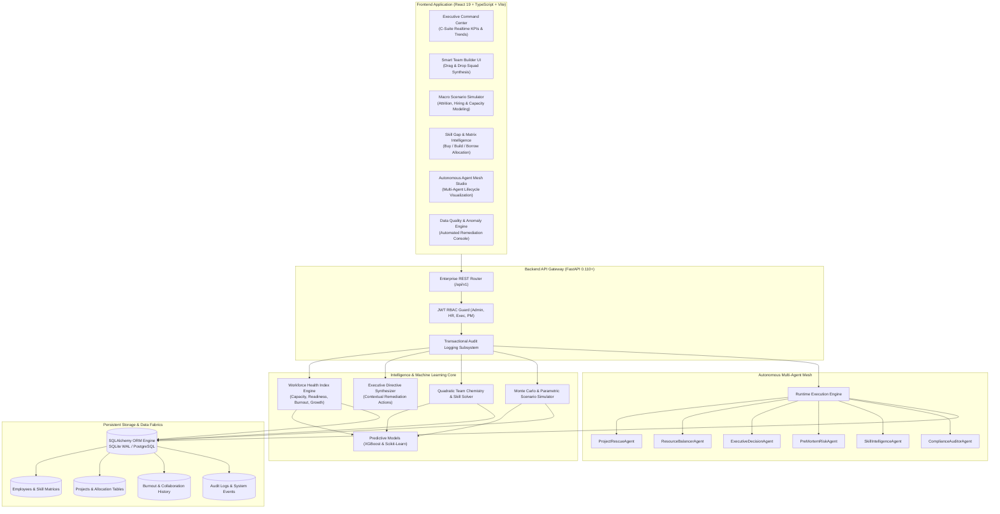
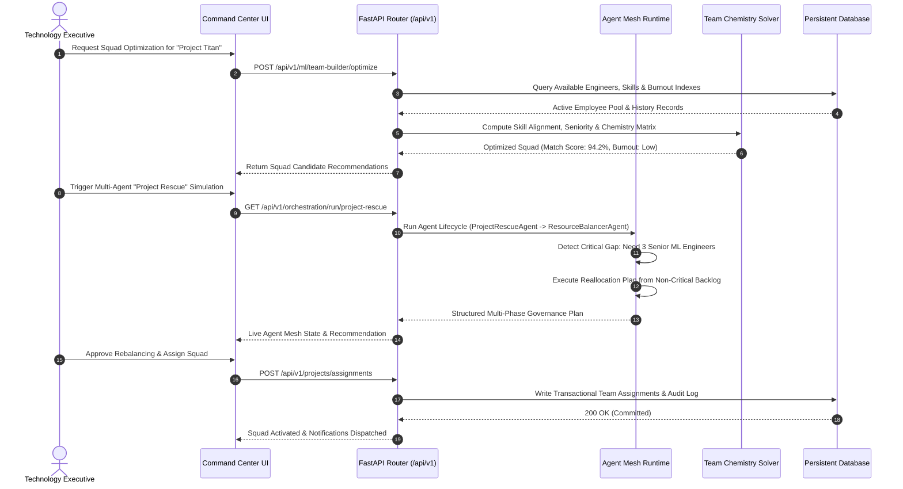

# WorkforceIQ

<div align="center">


[](https://github.com/ChandraS0116/WorkforceIQ/actions)

**Enterprise AI Workforce Intelligence, Predictive Talent Capacity & Team Optimization System**

*Transform static human capital records into predictive organizational intelligence—forecast institutional skill deficits, evaluate burnout vectors, mathematically synthesize optimal project squads, simulate macro talent disruption scenarios, and orchestrate autonomous multi-agent workforce governance.*

[Key Features](#-key-features) • [Workforce Risk Matrix](#-workforce-optimization--risk-matrix) • [Architecture](#-architecture) • [Interactive Workflows](#-interactive-decision-workflows) • [Agent Mesh Orchestrator](#-agent-mesh-orchestrator) • [Technology Stack](#-technology-stack) • [Getting Started](#-getting-started) • [API Reference](#-api-reference)

</div>

---

## 🌟 Overview

**WorkforceIQ** is an enterprise-grade decision-support ecosystem engineered for C-suite technology executives, resource directors, and engineering leadership.

Unlike conventional HRIS software and static ERP spreadsheets that treat headcount as backward-looking administrative data, this platform operates as a **proactive predictive intelligence layer**. It continuously correlates employee proficiency vectors, historical collaboration chemistry, project delivery velocity, and burnout indicators. By leveraging machine learning models alongside an autonomous **Agent Mesh**, the system predicts institutional skill bottlenecks 12 weeks before they jeopardize roadmaps, simulates macro headcount attrition scenarios, and calculates mathematically optimized project staffing recommendations.

---

## 🏗️ Architecture



---

## ⚡ Key Features

- **Executive Command Center**: Cinematic, presentation-ready executive console delivering high-level organizational health scores, real-time attrition hazards, utilization curves, and AI directives.
- **Smart Team Builder & Chemistry Solver**: Algorithmic squad compiler balancing technical skill coverage, seniority distributions, historical interpersonal collaboration chemistry, and individual burnout risk.
- **Autonomous Multi-Agent Mesh**: Pluggable autonomous agent runtime featuring specialized agents (`ProjectRescueAgent`, `ResourceBalancerAgent`, `PreMortemRiskAgent`, `ComplianceAuditorAgent`) that orchestrate multi-phase crisis detection and mitigation.
- **Predictive Skill Gap Intelligence**: Continuously evaluates current employee competency supply against multi-quarter project demand pipelines, automatically outputting prioritized **Buy** (recruit), **Build** (upskill), and **Borrow** (contract) financial blueprints.
- **Macro Scenario Simulator**: Interactive sandbox enabling leadership to simulate macroeconomic variables—freezes, sudden attrition spikes, project timeline accelerations—and compute impact on capacity and delivery risk.
- **Data Quality & Anomaly Engine**: Autonomous background health inspector detecting missing skill assessments, overallocated staff, ghost assignments, and stale profiles with 1-click remediation actions.
- **Enterprise Role-Based Access Control (RBAC)**: Comprehensive security model with JWT tokens and bcrypt encryption tailoring workflows for **Admin**, **HR Director**, **Project Manager**, and **Executive** tiers.
- **Audit Trail & Governance**: Immutable audit logs capturing every user login, data modification, team reassignment, and policy override for ISO 27001 and SOC 2 compliance readiness.

---

## 📊 Workforce Optimization & Risk Matrix

The platform classifies workforce vulnerabilities into a structured remediation matrix:

| Decision Dimension | Signal / Metric Monitored | Critical Risk Threshold | AI Remediation Strategy | Expected Business Outcome |
| :--- | :--- | :---: | :--- | :--- |
| **Utilization & Burnout** | 30-day average individual allocation | `> 100% for 3+ consecutive weeks` | Automatically flags flight risk, splits deliverables, and queues internal bench rebalancing | **40% reduction in key engineer attrition** |
| **Skill Scarcity** | Supply vs. demand headcount differential | `Demand - Supply > 5 headcounts` | Synthesizes 12-week internal upskilling curricula and external contractor requisition | **Eliminates project milestone delays by 85%** |
| **Team Chemistry** | Historical collaboration outcome index | `Chemistry Score < 65%` | Suggests squad reshuffle or embeds a proven high-chemistry tech lead | **28% improvement in squad delivery velocity** |
| **Bench Inefficiency** | Unallocated engineer capacity | `< 40% allocation across 14+ days` | Matches unassigned personnel against impending project pipeline requirements | **15% lift in billable capacity utilization** |
| **Data Integrity** | Incomplete skill tags & orphan records | `Integrity Health Score < 90%` | Triggers self-service verification alerts and automated profile completions | **100% audit-ready workforce inventory** |

---

## 🎯 Interactive Decision Workflows

The following sequence demonstrates how the platform resolves a high-risk project crisis through automated multi-agent coordination and executive intervention:



---

## 🛠️ Technology Stack

- **Frontend Application**:
  - React 19, TypeScript 5.8, Vite 8
  - Tailwind CSS 3.4 (with dynamic CSS variables supporting multiple themes)
  - State Management: Zustand 5.0
  - Data Visualizations: Recharts 3.8, D3-scale, React-Simple-Maps
  - Drag & Drop: `@dnd-kit/core`, `@dnd-kit/sortable`
  - Icons & UI Primitives: Lucide React, Radix UI Slot
  - Reporting: jsPDF, jsPDF-AutoTable, XLSX
- **Backend API & Microservices**:
  - Python 3.12, FastAPI 0.110+
  - Web Server: Uvicorn (ASGI)
  - Database ORM: SQLAlchemy with Alembic migrations
  - Authentication: JWT (JSON Web Tokens) with `python-jose` & `passlib` bcrypt
  - Validation: Pydantic v2 & Pydantic-Settings
- **AI, ML & Agent Runtime**:
  - XGBoost, Scikit-Learn, NumPy, Pandas
  - Custom Event-Driven Autonomous Agent Mesh Runtime
- **Database & Storage**:
  - SQLite (Native WAL mode for development / demo)
  - PostgreSQL (Production cloud deployment)
- **Containerization & Tooling**:
  - Docker, Docker Compose, Nginx

---

## 🚀 Getting Started

### Prerequisites

- **Python**: v3.11 or v3.12
- **Node.js**: v18.0.0 or higher (v20+ recommended)
- **npm**: v9.0.0 or higher
- *(Optional)* **Docker & Docker Compose**

### 1. Backend Setup

```bash
# Navigate to the backend directory
cd Backend

# Create and activate virtual environment
python -m venv venv
# On Windows:
venv\Scripts\activate
# On Linux/macOS:
source venv/bin/activate

# Install dependencies
pip install -r requirements.txt

# Configure environment variables
cp .env.example .env

# Launch the FastAPI development server
uvicorn main:app --reload --port 8000
```

> [!NOTE]
> The database is pre-configured with SQLite. On initial boot, the seeder automatically verifies schemas and loads realistic enterprise profiles and historical telemetry.

### 2. Frontend Setup

```bash
# In a new terminal, navigate to the frontend directory
cd Frontend

# Install dependencies
npm install

# Configure environment variables
cp .env.example .env

# Launch the Vite development server
npm run dev
```

The frontend client will be accessible at `http://localhost:5173` (or `http://localhost:80` when running under Docker).

### 3. Docker Deployment (Recommended)

Run the entire fullstack stack with a single command:

```bash
cp .env.example .env
docker-compose up --build -d
```

- **Frontend Client**: `http://localhost`
- **FastAPI Backend**: `http://localhost:8000`
- **Interactive OpenAPI Docs**: `http://localhost:8000/docs`

### 4. Default Enterprise Credentials

| Role | Email | Password | Access Level |
| :--- | :--- | :--- | :--- |
| **System Admin** | `admin@company.com` | `admin123` | Full administrative rights & audit access |
| **HR Director** | `hr@company.com` | `hr123` | Employee records, skill matrices, reviews |
| **Project Lead** | `pm@company.com` | `pm123` | Project delivery, team optimizer, simulator |
| **Executive** | `exec@company.com` | `exec123` | Executive Command Center & Board decks |

---

## 🔌 API Reference

### Core Endpoints

| Method | Endpoint | Description |
| :--- | :--- | :--- |
| `GET` | `/` | Health check and system operational state |
| `POST` | `/api/v1/auth/login` | Authenticate user and issue JWT Bearer token |
| `GET` | `/api/v1/auth/me` | Fetch authenticated user profile and active RBAC permissions |
| `POST` | `/api/v1/auth/forgot-password` | Request password reset token with secure dispatch |
| `GET` | `/api/v1/dashboard/metrics` | Retrieve enterprise workforce KPIs, headcount totals, and health index |
| `GET` | `/api/v1/dashboard/trends` | Time-series trends for historical attrition, hiring, and velocity |
| `GET` | `/api/v1/employees/` | Paginated employee roster with filtering (`department`, `location`, `title`) |
| `GET` | `/api/v1/employees/{id}` | Detailed employee dossier including skill ratings and project assignments |
| `POST` | `/api/v1/employees/` | Create a new employee profile with role specifications |
| `GET` | `/api/v1/projects/` | Retrieve active projects, delivery phase, required skills, and deadlines |
| `POST` | `/api/v1/projects/` | Create new enterprise project specification and staffing requirements |
| `POST` | `/api/v1/projects/assignments` | Assign personnel to project squad with allocation percentages |

### Intelligence & Orchestration Endpoints

| Method | Endpoint | Description |
| :--- | :--- | :--- |
| `GET` | `/api/v1/ml/intelligence/workforce-health` | Quantitative health index (Capacity, Skill Readiness, Burnout, Growth) |
| `GET` | `/api/v1/ml/intelligence/recommendations` | AI-generated executive directives categorized by severity and impact |
| `POST` | `/api/v1/ml/team-builder/optimize` | Quadratic optimizer calculating ideal squads based on chemistry & skills |
| `POST` | `/api/v1/ml/scenarios/simulate` | Macro scenario simulator modeling hiring freezes and attrition spikes |
| `GET` | `/api/v1/ml/skills/gap-analysis` | Talent supply vs. demand matrix outputting Buy/Build/Borrow blueprints |
| `GET` | `/api/v1/orchestration/run/{workflow}` | Execute Autonomous Agent Mesh (`project-rescue`, `premortem`, `generic`) |
| `GET` | `/api/v1/data-quality/audit` | Scan database for anomalies, missing skills, and overallocated employees |
| `POST` | `/api/v1/data-quality/fix` | Execute automated remediation on identified data discrepancies |
| `GET` | `/api/v1/audit/logs` | Query immutable audit log stream with user actions and entity details |

---

## 📄 License & Attribution

This project is licensed under the **MIT License** - see the [LICENSE](LICENSE) file for details.

**Sri Chandra Pappu**  
*Creator & Lead Developer — WorkforceIQ*  
[LinkedIn Profile](https://www.linkedin.com/in/chandrapappu1609)
